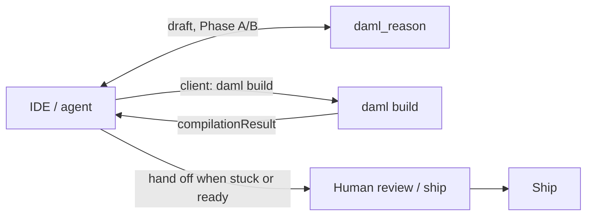

# 1. What it is

**About two minutes**

`daml_reason` is one MCP tool. Agents in Cursor and jobs in CI see the **same** analysis contract.

Your **agent** normally calls the tool; you may call it directly, and CI can use the same contract.

| Phase | Agent or CI caller sends | What it does |
|-------|--------------------------|--------------|
| **A** | `businessIntent` only | Ground you in **strong** corpus patterns, or **abstain** |
| **B** | plus `damlCode` (and optionally `compilationResult`) | A structured verdict: fix, compile next, hand off, or pass — see [How the verdict is decided](03-phase-b.md#how-the-verdict-is-decided) |

### Who does what

| Actor | Job |
|-------|-----|
| **Agent** | Drafts `damlCode`, calls the tool, may run `daml build` when the toolchain is available |
| **`daml_reason`** | Searches a **promoted** corpus bundle, applies trust gates, returns a verdict |
| **Human** | Owns ship; compiles if the agent cannot; decides on `abstain` or plateau handoffs |

Each agent and CI job checks against the **same versioned corpus** and receives the **same outcome fields**. Promoting or fixing that corpus changes the guidance future sessions receive — not a private chat memory.

Generation stays in the IDE. The server retrieves, gates, and says whether to continue.

### Names

- **Daml Reason** is the MCP tool (`daml_reason`).
- Do not brand the hosted surface as “Autopilot.” That name is being retired; it overpromises autonomy this product does not claim.

### What it will not do

- Generate Daml for you  
- Compile Daml on the server  
- Invent patterns when the corpus does not cover the ask  
- Always answer (vague or weak recall → `abstain`, with **no** weak hit list)

Corpus knowledge is ops-bound: a promoted canton-corpus **release bundle**. If the bundle is missing or empty, the tool fails closed instead of improvising.

In the private repo, the one-page capability brief is `docs/internal/DAML_REASON.md`.

---

[← Start](index.md) · [Phase A →](02-phase-a.md)
