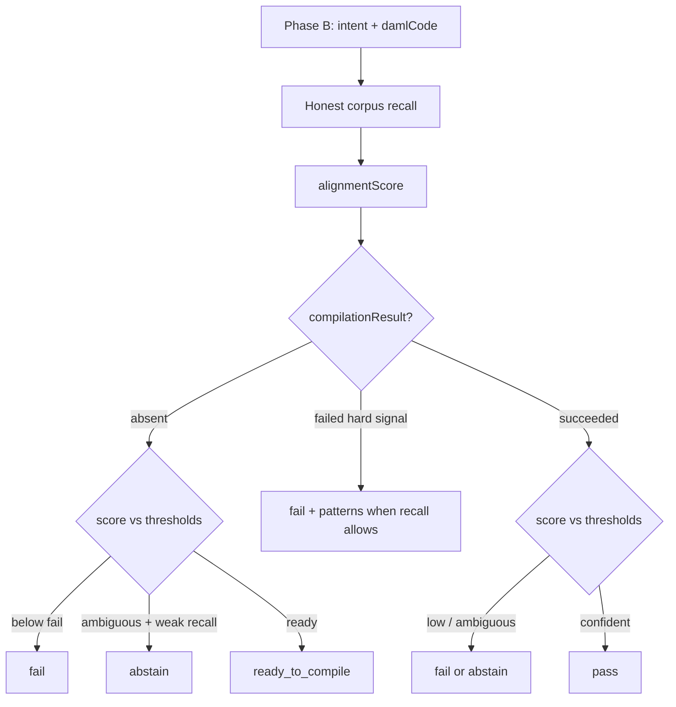

# 3. Phase B - intent + code

**About two minutes**

Call with `businessIntent` **and** `damlCode`. Optionally add `compilationResult` from a **client** compile (`daml build` / `damlc` on your machine or in CI).

### Outcomes

| Outcome | Meaning |
|---------|---------|
| `ready_to_compile` | Alignment looks good enough. Stop the semantic loop and **compile next**. |
| `fail` | Not acceptable yet. Strong patterns attached when recall allows (fail-and-help). |
| `abstain` | Too uncertain. A human should decide. |
| `pass` | Only after a **successful** client compile **and** the remaining gate. |

### Hard rules (easy to remember)

- No `compilationResult` → **`pass` is forbidden**  
- Compile failed (`succeeded: false` or non-zero `exitCode`) → always **`fail`**  
- Every Phase B response includes **`alignmentScore`**  
- There is no parallel `valid` bool. The outcome string **is** the verdict.  

### Compile hard signal

The client supplies compile status (`succeeded` and/or `exitCode`). The MCP **never** runs the compiler. On failure, optional `errors`, `diagnostics`, `stderr`, or `stdout` may be echoed in `issues` for humans and agents to read — the server does **not** parse compiler output into tailored fixes or change `alignmentScore` from diagnostics.

### How the verdict is decided

The server retrieves corpus patterns relevant to the intent, then uses a **heuristic alignment score** on the submitted draft to choose revise vs compile vs pass. The cross-encoder **selects and ranks** patterns; it does **not** verify your code. When you attach `compilationResult`, the server reads only the hard signal you report; **`pass` means these gates passed**, not that business behavior was proved correct.

Today’s score mixes token coverage of intent vs code with strong corpus hits (`FailBelow` 0.40 / `ReadyAt` 0.70). It is good enough to drive a draft loop. It is not a formal proof that the economics are right. Treat misses as calibration feedback for the corpus and the scorer, not as “the tool failed forever.”

Frozen field rules: `docs/internal/TOOL_CONTRACT.md` (Phase B), private repo.

---

[← Phase A](02-phase-a.md) · [Agent loop →](04-agent-loop.md)
