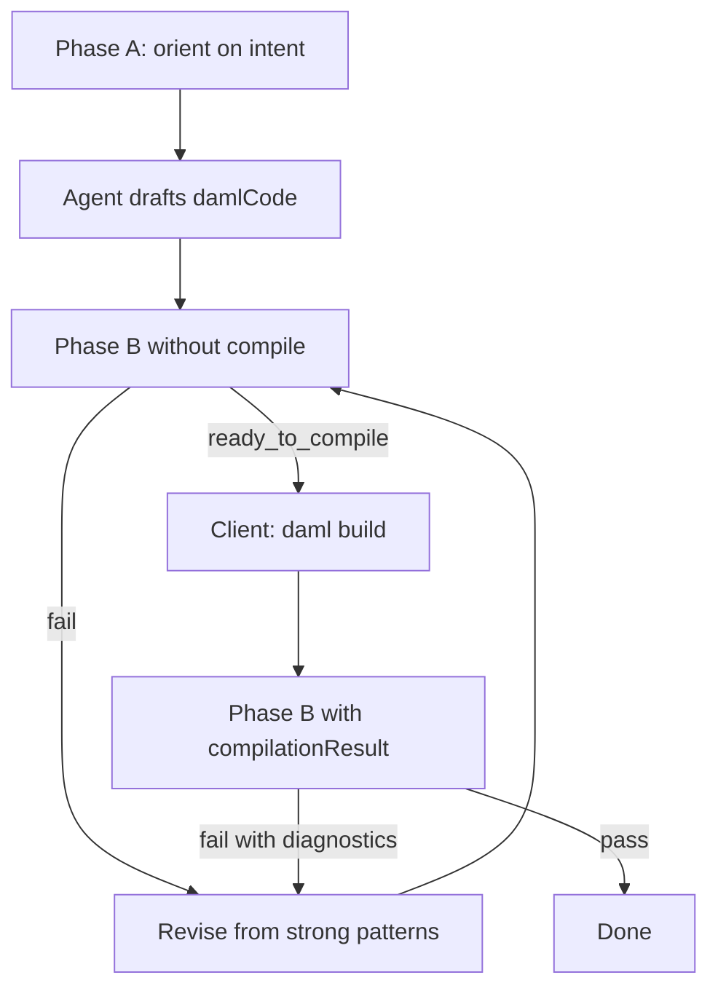

# 4. Agent draft loop

**About two minutes**

This is how agents should use the tool day to day: not one-shot generation, but a small loop that **stops** when the corpus has nothing more useful to say.

Revise using retrieved patterns. If two failed revisions have nearly the same `alignmentScore` (within about 0.05) and no new useful pattern symbols appear, **stop asking this corpus for more guidance** — the draft may still be wrong. Hand the unresolved issue to a person; compile only when the outcome is `ready_to_compile`.

### When to stop (“as good as the corpus allows”)

Stop and hand off when **any** of these is true:

1. Outcome is **`ready_to_compile`** - next step is compile  
2. Outcome is **`pass`** - done for this loop  
3. **Plateau** - two consecutive fails with `alignmentScore` within about 0.05 and no new useful pattern symbols  
4. **Cap** - for example four Phase B turns. Do not thrash.  

### What to give the human on handoff

1. Final `damlCode`  
2. Last `outcome`, `alignmentScore`, and **`reasoning`** (fixed server text from score band and compile status — not an LLM line-by-line code review)  
3. Corpus anchors (`path` / `sourceUrl`) and any `issues`  
4. A clear ask: compile, or paste `damlc` diagnostics back into Phase B  

Worked script in the private repo: `docs/internal/DEMO_CHAT.md` Part 2.

---

[← Phase B](03-phase-b.md) · [Try it →](05-try-it.md)
